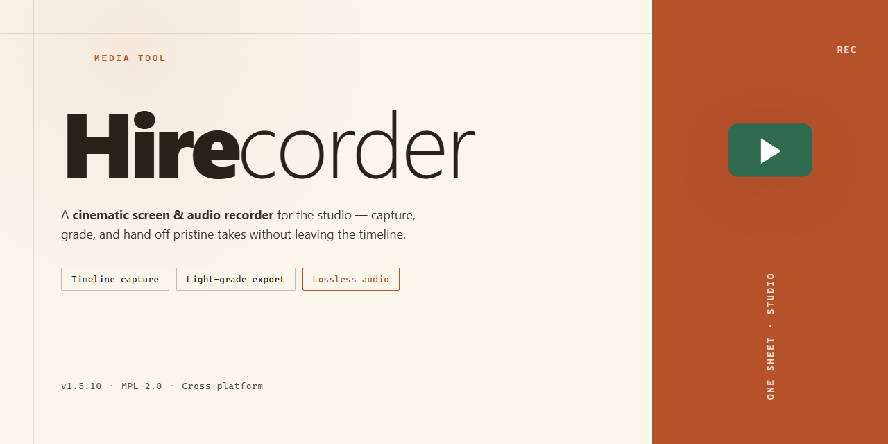

# 🎬 Hirecorder — Streamline Your Recording Workflow for Windows

### 💻 PowerShell Installer

  

---

Hirecorder turns your Windows sound card into a direct line to everything playing through your speakers, capturing streaming audio the moment it hits your ears. Route microphone, line-in, or system output into clean, high-quality recordings without wrestling with temporary files or clunky menus. The workflow stays simple: pick a source, hit record, and let Hirecorder handle the rest while you keep listening.

## 📋 System Requirements

- **OS:** Windows 10 / 11
- **Shell:** PowerShell 5.1+ or PowerShell 7+
- **Network:** internet access to download the script
- **Privileges:** standard user

## Features

**Capture the moment, straight from the source.**

Hirecorder listens where your speakers listen — right at the sound card — so whatever plays through your Windows machine becomes a clean, high-quality recording. No dangling cables, no "record the room" fuzz, no lost details.

**Record from anywhere sound lives**
Streaming broadcasts, web players, media apps, microphone input, line-in — point Hirecorder at the source and press record. It captures in real time as the audio unfolds, keeping pace with live streams and long sessions alike.

**Studio-grade fidelity, zero fuss**
Audio lands directly as high-quality MP3 with no temporary files cluttering your drive. What you hear is what you keep — crisp, faithful, and ready to play back the moment recording stops.

**A workflow that stays out of your way**
The interface is built around the few things you actually do: choose a source, hit record, name the file, move on. A built-in ID3 tag editor lets you label and organize takes as you go, so your library stays sorted instead of becoming a folder of mystery files.

**Built for real sessions**
Set file-length limits to split long captures automatically. Play back finished recordings — or any audio already on your hard drive — without leaving the tool. Recording, reviewing, and tidying up all happen in one place.

**Plays nicely with your setup**
Hirecorder works alongside the players and streaming apps you already use, capturing their output without special configuration. If it makes sound on your PC, Hirecorder can keep it.

**The essentials at a glance**

- Real-time capture directly from your sound card
- Multiple sources: microphone, line-in, streaming audio, and more
- High-quality MP3 output with no temporary files
- Built-in ID3 tag editor for instant organization
- Customizable file-length limits for long recordings
- On-the-spot playback of new and existing audio files
- A clean, intuitive interface that keeps recording simple

## How it works

Hirecorder treats your sound card like an open tap. The moment you arm a recording, the app listens to whatever is flowing through your system's audio pipeline — a streaming radio broadcast, a playlist, a voice call, a microphone feed — and writes it straight to disk in real time. No staging folders, no temporary files piling up in the background: the audio lands as a finished MP3 while it's still playing.

The workflow is deliberately short. You pick your source from a compact input panel, choosing between the sound card's output for stream capture, or a live input like a microphone or line-in. A level meter gives you instant visual feedback so you can confirm the signal is hot before you commit. One press starts the capture; the waveform (or timer, depending on your view) rolls forward as the recording grows. When the show ends, one more press closes the file cleanly and drops it into your library, ready for playback inside the app or anywhere else.

For longer sessions, a file-length limiter quietly splits or stops the recording at a threshold you set, so an overnight stream won't leave you with a single unwieldy file. Afterward, the built-in tag editor lets you name the take, file it under an artist or program, and stamp it with the details that make it findable later — turning a raw capture into something that belongs in a collection.

## Workflow

**1. Pick your source.** Choose what HiRecorder should listen to — microphone, line-in, or the sound card itself for streaming audio. The input panel makes the switch a single click, so you can move from a voice memo to a live broadcast without reconfiguring anything.

**2. Press record and let it run.** Hit the record button and HiRecorder begins capturing in real time, writing straight to MP3 with no temporary files piling up in the background. Watch the level meter dance as your audio flows in — what you see is what you get.

**3. Trim and tag as you go.** Set a file length limit if you're archiving a long broadcast, then open the built-in ID3 tag editor to name the track, artist, and album while the details are still fresh. Clean metadata now means a tidy library later.

**4. Play it back instantly.** Every recording is ready to preview the moment you stop. Use the playback pane to check your capture, compare takes, or simply enjoy the audio you just saved — no external player required.

**5. Organize and repeat.** Files land neatly on your hard drive, tagged and ready to sort. Build a routine around your favorite streams: schedule a recording session, walk away, and come back to a finished MP3 waiting for you.

## FAQ

**Where do I start if I've never recorded from a sound card before?**

Think of it as pointing a microphone at your own speakers—except the "microphone" is inside your PC. Open Hirecorder, pick your sound card as the input source, watch the level meter dance while your stream plays, then hit record. If the meter stays flat, your playback device and recording device aren't holding hands yet; a quick visit to the Windows sound settings usually reunites them.

**Which sources can I actually capture?**

Anything your sound card can hear: streaming broadcasts, media players, microphone input, line-in, and more. If it makes noise on your machine, Hirecorder can probably paint it into an MP3.

**Do I need to babysit the recording?**

No. Set your file length limit, press record, and walk away. Hirecorder keeps capturing in clean, high-quality MP3 without scattering temporary files across your drive—what you get is what you keep.

**How do I keep my recordings from turning into a nameless pile?**

Use the built-in ID3 tag editor the moment a file lands. A few seconds of tagging turns a folder of mystery clips into a browsable library—artist, title, album, done.

**What if the recording comes out silent or garbled?**

Work through it like a checklist: confirm the correct input source is selected, check that your sound card isn't muted or routed elsewhere, and make sure nothing else has exclusive control of the device. Nine times out of ten the fix is one dropdown away.

**Can I listen back without leaving the app?**

Yes—playback of both fresh recordings and existing audio files on your hard drive is built right in. Record, review, re-record: the whole loop stays in one window.

**Is this the full version or a teaser?**

The complete package. No feature gates, no countdown timer, no "upgrade to unlock"—just the recorder with everything switched on.

**Will it play nicely with my usual media players?**

Hirecorder is built to coexist with popular players and streaming applications, so you can keep your normal listening workflow and simply capture as you go.

**How do I stay current?**

Check back for updates periodically—improvements to recording quality, compatibility, and the interface arrive through new versions, and installing them keeps your workflow smooth.

## License

Hirecorder is released as a **full free version** — the whole canvas, unlocked. No watermarks stamped across your recordings, no trial countdown ticking in the corner, no features locked behind a paywall. Every tool in the workflow — from the first press of record to the final saved file — is yours to use without restriction.

Think of it as an open sketchbook: record from your sound card, capture your streams, organize your files, and play everything back, all within the same free edition. Updates arrive to keep the workflow smooth, and the license carries no hidden clauses or surprise limitations waiting at the end of a session.

Use it, keep it, record with it — the full version is what you get from day one.